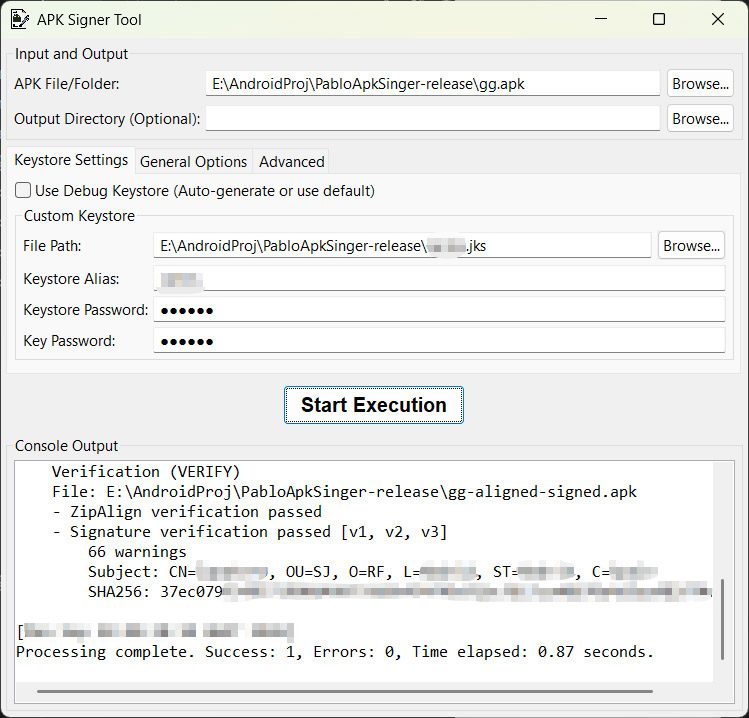

# PabloApkSigner

A Java-based utility for aligning and digitally signing (V1~V4 scheme compatible) Android APK files, featuring a Graphical User Interface (GUI), integrated zipalign functionality, and detailed signature verification output.

## Overview

This project provides a convenient desktop application for the critical step of signing Android packages. It wraps the core functionality of the official Android `apksigner` library, enhances the process with an independent, custom-built `zipalign` implementation, and presents all operations through a user-friendly GUI built with the Standard Widget Toolkit (SWT).

## Core Mechanism

The tool is designed to provide a comprehensive, multi-step process for preparing and signing APKs:

1.  **Configuration**: Load user arguments from the GUI into an `Arg` object, including input file paths, keystore credentials, and signing scheme flags.
2.  **ZipAlign (Optional)**: If not skipped, the tool performs a `zipalign` operation on the APK using its custom implementation found in `ZipAlign.java`. This ensures uncompressed data starts at specified byte boundaries (e.g., 4-byte, and optionally 16KiB for `.so` files) for efficient runtime resource loading.
3.  **Signing**: The actual digital signing is performed by calling the official Android **`ApkSignerTool`** via its internal API (`com.android.apksigner.ApkSignerTool`), applying the selected signing schemes (V1, V2, V3, V4) and keystore configuration.
4.  **Verification**: After signing, the integrity and signature are verified using a custom wrapper around `com.android.apksig.ApkVerifier`, providing detailed verification results and extracted certificate information.

## Features

- **GUI-Driven Workflow**: Easy-to-use graphical interface built with SWT, eliminating the need for command-line arguments.
- **Comprehensive Scheme Support**: Enables signing using all major Android signing schemes: V1 (JAR signing), V2 (Full APK Signature Scheme v2), V3 (APK Signature Scheme v3, for key rotation), and V4 (APK Signature Scheme v4, for incremental file system).
- **Built-in ZipAlign**: Includes a native Java implementation of the `zipalign` tool, which can align uncompressed entries to the specified boundaries (default 4 bytes) and optionally align `.so` files to a larger boundary (default 16KiB).
- **Flexible Keystore Management**:
    * Supports using a custom release keystore with alias, keystore password, and key password.
    * Automatic discovery and handling of the default Android debug keystore.
- **Detailed Verification**: Provides structural output for verification, including per-scheme verification status, error/warning lists, and a summary of signer certificate details (Subject DN, Issuer DN, SHA-256 hashes, Expiry, Key Size).
- **Hash Validation**: Ability to check the resulting APK signature against a list of provided SHA-256 certificate hashes for security and compliance.
- **Processing Flags**: Options for "Verify Only," "Dry Run," "Overwrite Original File," and toggles for verbose or debug logging.
- **Drag & Drop support**: The apk input & output path, and keystore file path can be automatically filled in by dragging the file into the edit box.
- **Keystore Configuration Persistence**: Configurations such as keystore paths, aliases, and passwords can be automatically loaded from persistent XML files, as well as automatic synchronization of current configurations into XML.

## Usage (GUI Operation)

To use the tool, follow these steps in the graphical interface:

1.  **Input and Output**:
    * Specify the target APK file or a folder containing APKs in the **APK File/Folder** field.
    * Optionally specify an **Output Directory** for the signed/aligned files.
2.  **Keystore Settings**:
    * Check **Use Debug Keystore** to automatically use a debug key, or uncheck it to use a **Custom Keystore**.
    * For a Custom Keystore, provide the `File Path`, `Alias`, `Keystore Password`, and `Key Password`.
3.  **General Options (Signing Schemes)**:
    * Select which **Signing Schemes** (V1, V2, V3, V4) should be applied during the signing process.
4.  **General Options (Processing Flags)**:
    * Configure flags like `Verify Only` (skips signing), `Skip ZipAlign`, `Overwrite Original File`, and `Allow Resign`.
5.  **Advanced Options**:
    * If using V3 signing for key rotation, specify the path to the **Lineage File**.
6.  **Execute**:
    * Click the **Start Execution** button.
    * The results, status, errors, and verification details will be streamed to the **Console Output** area.

## Screenshots

## Dependencies

The project relies on two main external libraries for its core functionality:

| Dependency | Purpose | Source File Reference |
| :--- | :--- | :--- |
| **Android `apksigner` Library** | Core digital signing and some verification logic (used internally). | `SignTool.java`, `AndroidApkSignerVerify.java` |
| **Eclipse SWT** (Standard Widget Toolkit) | Provides the cross-platform GUI framework. | `ApkSignerGui.java` |

## License

The project is licensed under the Apache License, Version 2.0 (the "License"). See [LICENSE](LICENSE) for details.